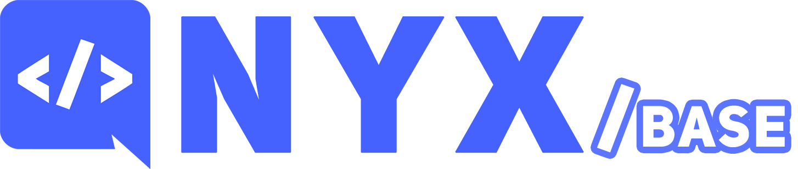

---

`@nyx-discord/base` is the foundation of [nyx](https://github.com/nyx-discord/nyx). It holds the interfaces every
nyx component follows, plus default implementations of them, without depending on any Discord library.

> [!TIP]
> **Building a bot?** You don't need to install this package directly. Install the adapter for your library, which
> re-exports everything from here:
>
> | If your bot...                       | Install                                                                          |
> |--------------------------------------|----------------------------------------------------------------------------------|
> | Uses discord.js                      | [`@nyx-discord/djs`](https://www.npmjs.com/package/@nyx-discord/djs)             |
> | Uses @discordjs/core                 | [`@nyx-discord/djs-core`](https://www.npmjs.com/package/@nyx-discord/djs-core)   |
> | Receives interactions over HTTP      | [`@nyx-discord/http`](https://www.npmjs.com/package/@nyx-discord/http)           |

## 🧱 What's inside

Every part of nyx (command manager, resolver, deployer, event dispatcher, error handler...) is an interface with a
default implementation, so you can replace any of them with your own. You can tell them apart by their names:

| Name                                 | Meaning                                                                                |
|--------------------------------------|----------------------------------------------------------------------------------------|
| No prefix (`CommandManager`)         | An interface: what a component does, and what the rest of nyx expects.                 |
| `Abstract*` (`AbstractSchedule`)     | Needs to be extended to be used, like your own commands, subscribers and schedules.    |
| `Basic*` (`BasicEventBus`)           | A complete, simple implementation. Use it directly, or extend it.                      |
| `Default*` (`DefaultCommandManager`) | The implementation the bot uses internally. Extend it and inject your version.         |
| `Base*` (`BaseCommand`)              | A library-agnostic foundation that the adapters build on.                              |

## 📦 Entry points

| Import                       | Contains                  |
|------------------------------|---------------------------|
| `@nyx-discord/base`          | Everything.               |
| `@nyx-discord/base/types`    | Only the interfaces.      |
| `@nyx-discord/base/defaults` | Only the implementations. |

## 🧩 Building something for nyx

If you're writing a plugin or library for nyx, depend on `@nyx-discord/base` instead of an adapter, so it works with all
of them. Importing from `@nyx-discord/base/types` makes it impossible to accidentally depend on an implementation:

```ts
import type { NyxBot, NyxPlugin } from '@nyx-discord/base/types';

export class MyPlugin implements NyxPlugin {
  public static readonly Id = Symbol('my-plugin');

  public async onRegister(bot: NyxBot) {
    // add commands, subscribers and schedules to the bot
  }

  public async onUnregister(bot: NyxBot) {
    // remove them
  }

  public getData() {
    return { name: 'my-plugin', version: '1.0.0', description: 'Does something useful' };
  }

  public getId() {
    return MyPlugin.Id;
  }
}
```

## 📖 Documentation

- [Guide](https://nyx-discord.github.io/nyx/guide/use/packages): how the packages fit together, and the
  [Extend](https://nyx-discord.github.io/nyx/guide/extend) section for replacing nyx's internals.
- [Guide as Markdown for AI agents](https://nyx-discord.github.io/nyx/guide/llms.txt), or install the agent skill with
  `npx skills add nyx-discord/nyx`.
- [API reference](https://nyx-discord.github.io/nyx/docs): every class, interface and type.
