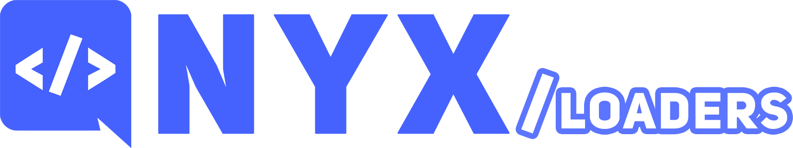

---

`@nyx-discord/loaders` provides directory-scanning loaders for [nyx](https://github.com/nyx-discord/nyx). Instead of
importing and registering every command, event subscriber and schedule by hand, point a loader at a directory: it scans
the `.js` / `.mjs` files, instantiates the exported classes and adds them to your bot.

Works with every nyx adapter (`@nyx-discord/djs`, `@nyx-discord/djs-core` and `@nyx-discord/http`).

## 📥 Installing

```bash
npm i @nyx-discord/loaders
```

## 🚀 Usage

```ts
import { CommandLoader, EventLoader, ScheduleLoader } from '@nyx-discord/loaders';

// load before bot.start(); paths point to your compiled output, relative to the working directory
await CommandLoader.load({ bot, path: './dist/commands' });
await EventLoader.load({ bot, path: './dist/events' });
await ScheduleLoader.load({ bot, path: './dist/schedules' });

await bot.start();
```

Each loader returns what it loaded, already registered on the bot. Pass `register: false` to register them yourself, or
a `filter` to skip some files.

## 📂 Command folders

Filenames don't matter: the command hierarchy comes from each class's `data.name` and the folder structure.

```
dist/commands/
├── ping.js              standalone, parent or context menu command
├── mod.js               parent command with data.name 'mod'
├── mod/
│   ├── ban.js           subcommand of 'mod'
│   ├── settings.js      subcommand group with data.name 'settings'
│   └── settings/
│       └── view.js      subcommand of the 'settings' group
└── utils/               any other folder is just organization
    └── ...
```

Classes must be exported. A class can define a `static create(bot)` method (`static create(bot, parent)` for children)
instead of a constructor, to receive the bot.

## 📖 Documentation

- [Guide](https://nyx-discord.github.io/nyx/guide/loaders): options, and the rules for commands, events and schedules.
- [Guide as Markdown for AI agents](https://nyx-discord.github.io/nyx/guide/loaders.md), or install the agent skill
  with `npx skills add nyx-discord/nyx`.
- [API reference](https://nyx-discord.github.io/nyx/docs): every class, interface and type.
